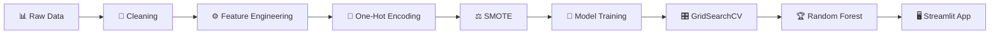

<div align="center">

# 💳 UPI Fraud Detection Using Machine Learning

### Detect fraudulent UPI transactions in real time with a tuned Random Forest model and a Streamlit web app

<p>
  
  
  
  
</p>

<p>
  
  
  
  
</p>

[Overview](#-overview) •
[Features](#-features) •
[Dataset](#-dataset--preprocessing) •
[Models](#-models--results) •
[Quick Start](#-quick-start) •
[Web App](#-web-app) •
[Structure](#-project-structure)

</div>

---

## 📌 Overview

**Unified Payments Interface (UPI)** is India's real-time digital payment system, processing billions of transactions every month. As adoption grows, so does the risk of fraud.

This project builds a **binary classification model** that flags whether a UPI transaction is:

| Label | Meaning |
|:-----:|---------|
| ✅ `0` | Legitimate transaction |
| 🚨 `1` | Fraudulent transaction |

The final model is served through an interactive **Streamlit app** where you can check a single transaction or upload a CSV for batch predictions.

---

## ✨ Features

- 🔍 **End-to-end ML pipeline**: cleaning, feature engineering, balancing, training, tuning, evaluation
- ⚖️ **Class imbalance handled** with SMOTE
- 🌲 **Four models compared**: Decision Tree, Random Forest, Gradient Boosting, XGBoost
- 🎛️ **Hyperparameter tuning** with GridSearchCV
- 🖥️ **Streamlit UI** for instant single-transaction checks
- 📂 **Batch prediction** by uploading a CSV file
- 💾 **Pre-trained model** (`upi_fraud_model.pkl`) included, so you can run the app right away

---

## 📊 Dataset & Preprocessing

The dataset is included as `UPI__DATA__SET.csv`. The following steps were applied:

1. 🧹 Removed duplicate records
2. 🕳️ Checked and handled missing values
3. 📅 Converted the date column to `datetime`
4. ⏱️ Extracted time-based features: **Year** and **Month**
5. 🔢 Applied **One-Hot Encoding** to categorical variables
6. 🗑️ Dropped unnecessary ID-based columns
7. ⚖️ Balanced the training set using **SMOTE** (Synthetic Minority Over-sampling Technique)

### Input features

| Feature | Description | Example values |
|---------|-------------|----------------|
| `Amount` | Transaction amount | `1500.0` |
| `Year`, `Month` | Derived from the transaction date | `2024`, `7` |
| `Transaction_Type` | Nature of the transaction | Bill Payment, Investment, Purchase, Refund, Subscription, Other |
| `Payment_Gateway` | UPI app / bank gateway | Google Pay, PhonePe, Paytm, HDFC, ICICI UPI, IDFC UPI, Razor Pay, Other |
| `Transaction_State` | Indian state of the transaction | Maharashtra, Karnataka, Bihar, ... |
| `Merchant_Category` | Type of merchant | Utilities, Travel bookings, Home delivery, Investment, ... |

---

## 🤖 Models & Results

Four models were trained and compared:

| Model | Type |
|-------|------|
| 🌳 Decision Tree | Single tree baseline |
| 🌲 **Random Forest** | **Bagging ensemble (selected)** |
| 🚀 Gradient Boosting | Boosting ensemble |
| ⚡ XGBoost | Optimized gradient boosting |

After evaluation and tuning, **Random Forest** delivered the best performance and was chosen as the final model.

### 🏆 Final Model Performance (Random Forest)

| Metric | Score |
|--------|:-----:|
| **Accuracy** | **94.9%** |
| **ROC-AUC** | **94.9%** |
| **F1-Score** | **~0.95** |

### ⚙️ Model Optimization

- Applied **SMOTE** to balance the training data
- Ran **GridSearchCV** for exhaustive hyperparameter search
- Re-trained Random Forest with the best parameters

> 💡 *RandomizedSearchCV is cheaper computationally, but GridSearchCV was used here for a thorough search.*

---

## 🧠 Key Insights

- 🌲 **Random Forest** performed best thanks to its ensemble approach, which reduces overfitting by combining many decision trees.
- ⚖️ **SMOTE** noticeably improved recall, meaning more fraudulent transactions are caught.
- 📏 **ROC-AUC and F1-score** were prioritized over plain accuracy, since accuracy can be misleading on imbalanced fraud data.

---

## 🛠️ Tech Stack

| Category | Tools |
|----------|-------|
| Language | Python |
| Data | Pandas, NumPy |
| Machine Learning | Scikit-learn, XGBoost, Imbalanced-learn (SMOTE) |
| Visualization | Matplotlib, Seaborn |
| Web App | Streamlit |
| Environment | Jupyter Notebook |

---

## 🚀 Quick Start

### 1️⃣ Clone the repository

```bash
git clone https://github.com/sanchit037nit/UPI-Fraud-Detection-Using-Machine-Learning.git
cd UPI-Fraud-Detection-Using-Machine-Learning
```

### 2️⃣ Create a virtual environment (recommended)

```bash
python -m venv venv

# Windows
venv\Scripts\activate

# macOS / Linux
source venv/bin/activate
```

### 3️⃣ Install dependencies

```bash
pip install streamlit pandas numpy scikit-learn xgboost imbalanced-learn matplotlib seaborn jupyter
```

> ⚠️ Use the same `scikit-learn` version the model was trained with, otherwise loading `upi_fraud_model.pkl` may raise a version warning or error.

### 4️⃣ Run the app

```bash
streamlit run app.py
```

The app opens at **http://localhost:8501** 🎉

### 5️⃣ (Optional) Explore the analysis notebook

```bash
jupyter notebook Raw_Payment_analysis_for_UPI_payment_systems.ipynb
```

---

## 🖥️ Web App

The Streamlit interface supports two modes.

### 🔹 Single transaction check

Fill in the form and click **Check Transaction(s)**:

- Transaction date
- Transaction type
- Payment gateway
- Transaction state
- Merchant category
- Amount

The app instantly tells you whether the transaction is **legitimate** or **fraudulent**.

### 🔹 Batch check via CSV

Upload a CSV with these columns:

| Column | Format / Example |
|--------|------------------|
| `Date` | `DD-MM-YYYY`, e.g. `15-07-2024` |
| `Transaction_Type` | `Purchase` |
| `Payment_Gateway` | `Google Pay` |
| `Transaction_State` | `Karnataka` |
| `Merchant_Category` | `Utilities` |
| `Amount` | `2500.50` |

The app returns your data with an extra **`Fraud`** column (`0` = legit, `1` = fraud).

> 📝 Category values must match the ones the model was trained on (see the feature table above).

---

## 📁 Project Structure

```text
UPI-Fraud-Detection-Using-Machine-Learning/
│
├── 📓 Raw_Payment_analysis_for_UPI_payment_systems.ipynb   # EDA, preprocessing, training & evaluation
├── 📊 UPI__DATA__SET.csv                                   # Dataset
├── 🧠 upi_fraud_model.pkl                                  # Trained Random Forest model
├── 🖥️ app.py                                               # Streamlit web application
└── 📄 README.md                                            # Project documentation
```

---

## 🔄 Workflow



---

## 🔮 Future Improvements

- [ ] Add confusion matrix, ROC curve and feature-importance plots to the README
- [ ] Add a `requirements.txt` with pinned versions
- [ ] Add input validation and clearer error messages for CSV uploads
- [ ] Display fraud probability scores instead of only a label
- [ ] Deploy the app on Streamlit Community Cloud
- [ ] Explore deep learning and anomaly-detection approaches

---

## 🤝 Contributing

Contributions, issues and feature requests are welcome!

1. 🍴 Fork the project
2. 🌿 Create your feature branch: `git checkout -b feature/AmazingFeature`
3. 💾 Commit your changes: `git commit -m "Add AmazingFeature"`
4. 📤 Push to the branch: `git push origin feature/AmazingFeature`
5. 🔃 Open a Pull Request

---

## 👤 Author

**Sanchit**

[](https://github.com/sanchit037nit)

---

<div align="center">

### ⭐ If you found this project useful, please consider giving it a star! ⭐

*Built with ❤️ to make digital payments safer.*

</div>